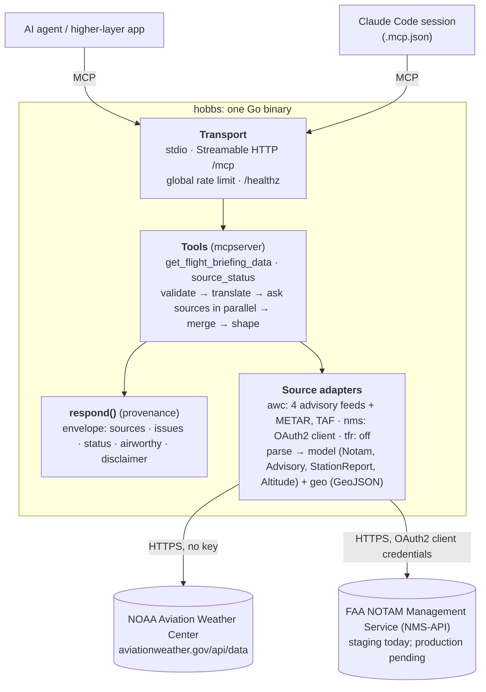
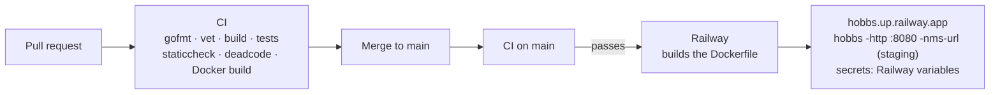

# Hobbs: design

## 1. Purpose and status

Hobbs is an MCP server that makes official US aviation data available to AI agents: FAA NOTAMs from the NOTAM Management Service (NMS-API), and METARs, TAFs and weather advisories (SIGMET, AIRMET, international SIGMET, CWA) from the NOAA Aviation Weather Center (AWC). One data tool, `get_flight_briefing_data`, returns all of them for a flight's airports in one call, each kind in its own sublist; a second tool, `source_status`, checks the sources. Every response says where its data came from, when, and what went wrong getting it.

**Status (2026-11-24):** v1 is built and hosted at `https://hobbs.up.railway.app/mcp`. On 2026-11-24 METARs and TAFs were added, and the one data tool replaced the two earlier ones, which asked for NOTAMs and advisories separately (§9). NOTAMs come from the FAA's **staging** environment, so the server is not airworthy (§5.6).

How to read this document:

- §2 **Principles** govern everything else. When a later section seems to conflict with §2, §2 wins.
- §3 **Product requirements** says who uses the server and the flows it must support.
- §4 **High-level design** shows the parts and how a request moves through them. §5 has the detail for each part.
- §6 covers testing and delivery, §7 safety and trust, §8 open items.
- §9 **Decisions log** records every decision, with the alternatives considered and why they lost.

This is a living document, updated in the same change as the code it describes (see `CLAUDE.md`).

## 2. Principles

> **The MCP layer makes the FAA's data available to the agent. Uniform, consistent, and available.**

- **Uniform:** every source comes out in the same shapes (one envelope, one NOTAM model, one advisory model, one station report for METARs and TAFs, one altitude type, one geometry form), so an agent does not learn a new format per source.
- **Consistent:** the same inputs give the same kind of output, with stable ordering, stable identifiers and the same behavior on errors, gaps and odd data.
- **Available:** the data is reachable when the sources are, and when it is not (or is partial, or from a test environment) the response says so, instead of failing quietly.

This layer is the foundation. The opinionated parts of the application (what matters for a flight, what to do about it) are built **on top of it, in separate layers**, by people and agents who choose their own logic. They are deliberately not here.

### 2.1 What this layer may do

Low-risk value-adds that make the data easier to consume without deciding anything for the user:

- Simplify and normalize: consistent field names, timestamps in UTC, coordinates in decimal degrees, one altitude representation, unit conversions, merging a source's multiple text renderings under one record.
- Interpret reasonably where a source is ambiguous or inconsistent (e.g. reading a limit stated as `6000FT AMSL`), **as long as** the original value is kept alongside, the interpretation is documented, and anything we could not interpret is flagged and not guessed.
- Forward the filters the official API supports, and say that the source applied them.
- Report on the data itself: where it came from, how old it is, what went wrong getting it.

### 2.2 What this layer must not do

Anything where there is a decent chance we would miss something, or where logic makes a decision for the user implicitly:

- Decide what is relevant, what applies to a route, a time, an altitude or an aircraft, or what is active now.
- Rank, score, prioritize, group by importance, summarize or advise.
- Remove, merge or hide records on the strength of our own judgment (including de-duplicating or "superseding" NOTAMs). The one merge we do is not a judgment: when several queries return the **same record** (the same FAA NMS id), it appears once. Records with different ids stay separate even when they say the same thing (an FDC NOTAM and its international copy are both returned), and cancellations are returned like any other record.
- Filter on anything the source does not filter on itself, beyond an exact match on a field the source publishes. A wrong "this applies" costs some attention; a wrong "this doesn't apply" is a silent omission that could hide the one item that mattered.
- Fill gaps with assumptions that change what the data says.

### 2.3 How to apply them

Before adding any behavior to this layer, ask:

1. **Does it change which records come back, or what a field means, in a way the caller cannot see or undo?** If yes, it does not belong here.
2. **If our logic is wrong, does the failure show or hide?** Showing (extra data, a flag, a visible parse issue) is acceptable. Hiding (a missing record, a silently changed meaning) is not.
3. **Is the original preserved next to anything we interpreted?** If not, it must be.
4. **Is it a decision the user or their agent would want to make themselves?** If yes, it belongs in a higher layer.

When in doubt, return the data as published, flag the doubt, and leave the decision to the layer above.

## 3. Product requirements

### 3.1 Users

- **AI agents** are the callers: an agent briefing a pilot, or a higher-layer application that decides relevance. They call the tools over MCP and read the JSON.
- **The maintainer** (single maintainer, hobby project) runs, deploys and checks the service.
- People reach the data only through an agent or a higher layer; the server has no user interface.

US focus. International SIGMETs are included because AWC publishes them.

### 3.2 User flows

**F1. Data for a flight.** The agent lists the flight's airports: departure, destination, alternates, and any it chooses to add.
1. It calls `get_flight_briefing_data` with `airports: ["KSMO", "KPSP", "KTRM"]`, optionally `centers` (en-route centers the flight also crosses, e.g. `ZAB`) and `include` (which sublists; default all seven).
2. The server translates that input into each source's own query and shows the translation in the response (`translation`). It asks every included source in parallel: the FAA once per airport and center, then once for each en-route center (ARTCC) the FAA lists on those NOTAMs (here `ZLA`); AWC once for the airports' METARs and once for their TAFs; and the four advisory feeds whole.
3. The agent gets one envelope with a sublist per kind: `notams`, `metars`, `tafs`, `sigmets`, `airmets`, `intl_sigmets`, `cwas`. Each NOTAM has its raw text and fields, and `returned_for` says which identifiers returned it; `locations.added` names the centers added and why, and a note says centers between the airports were not inferred. Each METAR and TAF has its raw text and AWC's decoded fields; an airport with no report is flagged `STATION_NO_DATA`. The advisories are the full current national sets. Geometry is included only when the agent asks (`include_geometry: true`).
4. The agent decides what matters: which advisories touch the route, time and altitude, which NOTAMs are in effect during the flight (there is no time filter, §3.4), and whether to call again with any other centers the route crosses.

**F2. Can I trust this answer?** In every response the agent reads `completeness.status` (only `complete` means a clean pull), the `issues`, `provenance.sources` (what was fetched, when, from where) and `airworthy`. To see why something was incomplete, it calls `source_status`, which checks every source live.

**F3. Connect a client.** A local client runs the binary over stdio. A remote client points at `https://hobbs.up.railway.app/mcp` (Streamable HTTP, open). Claude Code sessions on this repo load the hosted tools from `.mcp.json`.

**F4. Change, deploy and verify** (maintainer). A pull request runs CI; merging to `main` runs CI again, and Railway deploys the commit only after CI passes. The maintainer checks the deployment, then calls `source_status` through the MCP connection (§6).

### 3.3 Requirements

| # | Requirement |
|---|---|
| R1 | Every response states its sources, retrieval times and every data-pull problem (§5.1). There is no response without provenance. |
| R2 | Never present an empty result as "none" unless the pull was clean (`completeness.status` = `complete`). |
| R3 | Official sources only (FAA, NOAA); no third-party aggregators. Undocumented endpoints are labelled as such. |
| R4 | Filter only with the source's own filters, and say who applied each filter (`applied_by_source` / `applied_by_server`). Today every filter is the source's own, shown in `translation` (§5.2). |
| R5 | Return everything that matched: nothing ranked, summarized or dropped, and no result cap (there is no `limit` input, §9). |
| R6 | One geometry form for every shape (RFC 7946 GeoJSON); any approximation overstates, never understates (§5.4). |
| R7 | Raw source text on every record, treated as untrusted data. |
| R8 | Say whether the data may be used for flight (`airworthy`); false unless every source is production (§5.6). |
| R9 | Provided as is: best effort, no warranty, not presented as FAA or NWS data (§7). |
| R10 | Hosted, open endpoint with a global rate limit to protect upstream quotas. |

Accepted consequence: responses can be large (an airport can have hundreds of NOTAMs). The failure mode is visible (too much data), not hidden (a missing item).

### 3.4 Non-goals

- Relevance scoring, ranking, prioritizing, summarizing or "you should care about this" guidance.
- Route, corridor or area intersection; "active at time T"; altitude-overlap matching; labels such as "applies" or "does not apply". Agents do this themselves from the geometry and fields returned.
- A route input, or inferring the en-route centers between airports (§9).
- A time window. The FAA's effective-window filter returns only NOTAMs entirely inside the window (§5.5), so it would hide NOTAMs in effect during a flight; no other source would use it. There is no time input (§9).
- An area (bounding-box) input for METARs and TAFs: deferred (§8).
- The narrower NOTAM and advisory queries the earlier data tools offered (point and radius, NOTAM number, free text, feature, classification, accountability, last-updated, advisory hazard): dropped with those tools on 2026-11-24 (§8, §9).
- Weather products other than METARs, TAFs and the four advisory kinds (PIREPs, winds aloft, ...): not offered today.
- A TFR tool: no official source we can use publishes TFR outlines (§5.5).
- Flight-planning decisions or go/no-go advice.

## 4. High-level design



**The parts:**

- **Transport.** stdio for a local client; Streamable HTTP for the hosted service, stateless, with a global rate limit and an open health check (§5.6).
- **Tools** (`internal/mcpserver`). Two read-only tools: one data tool, `get_flight_briefing_data`, and `source_status`. The data tool validates its input (bad requests are refused before anything is sent upstream), translates it into each source's own query, calls the source adapters in parallel, merges the results and applies the caller's shaping (`include`, `include_geometry`) (§5.2).
- **The envelope** (`internal/provenance`). Every tool returns through one function, which builds the provenance envelope, derives the completeness status by rule and stamps `airworthy` and the disclaimer (§5.1).
- **Source adapters** (`internal/source/...`). One per upstream. Each fetches, parses into the shared model (`internal/model`) and records data-pull problems as issues instead of dropping records. Shapes are translated into canonical GeoJSON by `internal/geo` (§5.3, §5.4, §5.5).
- **The upstream services.** NOAA AWC (public, no key) and the FAA NMS-API (OAuth2; staging credentials today). The TFR adapter exists but is turned off and not linked into the binary.

**A request, end to end** (F1):

1. The agent calls `get_flight_briefing_data` with `airports: ["KSMO", "KPSP"]`.
2. The tool validates the input: 4-character ICAO identifiers, at most 10 airports and centers, known `include` values. Anything wrong comes back at once as a correctable error, and nothing is sent upstream. (A call with no `airports` field at all is refused earlier, by the MCP SDK's check against the input schema, so that message is the SDK's.)
3. It translates the input into one query per source. The translation is a pure function of the validated input, returned in the response as `translation`.
4. It asks the included sources in parallel. NOTAMs: the NMS-API once per airport and center, each query its own provenance source (`faa.nms.notam:KSMO`), then once for each new en-route center the FAA lists on those NOTAMs (`faa.nms.notam:ZLA`). METARs and TAFs: one AWC request each for all the airports (`awc.metar`, `awc.taf`). Advisories: the four AWC feeds, whole.
5. It merges the NOTAMs (the same NMS id appears once, with `returned_for`), flags any airport with no METAR or no TAF (`STATION_NO_DATA`), puts each source's records in their sublist in the source's order, and removes geometry unless `include_geometry` is true.
6. `respond()` builds one envelope over all of it: every source with retrieval time and counts, every issue, the derived status, `airworthy: false` and the disclaimer. A failed source makes the response `incomplete` without hiding the others.

**No cache.** Every call fetches from the source live, so `served_from` is always `live`. A cache is added only on a measured need and must keep the same provenance contract.

**Delivery:**



## 5. Detailed design

### 5.1 The response envelope and provenance

**Every tool response, with no exceptions, states which official sources it used, when each was retrieved, and every problem with the data pull that could affect the result.** Agents read absence of evidence as evidence of absence, so the server must make that mistake impossible to make by accident.

Rules:

1. **Official sources only.** Each source records its authority, URL and whether its endpoint is *documented* or *undocumented*; undocumented status is reported to callers.
2. **No response without provenance.** Handlers cannot return bare data. Every tool response goes through one function (`respond`, which calls `provenance.New`), which validates the provenance and derives the status; tests check every tool's output is a valid envelope.
3. **Never say "none" unless it is true.** An empty result reads as a clean "nothing found" only when `completeness.status` is `complete`.
4. **Report what was not checked**, not only what was. Sources that were skipped, disabled or failed appear in the response.
5. **Degrade, don't hide.** Partial parses and missing geometry are returned and flagged, never dropped or silently patched.
6. **Published text alongside parsed fields; the source record when there is none.** `raw_text` holds only text the source published, unaltered, and `raw_format` names its kind: `icao_notam` (ICAO-format NOTAM), `us_notam` (US domestic NOTAM; the NMS-API calls it `LOCAL_FORMAT`, the TFR feed `USNS`), `advisory_text` (a weather advisory as issued), `metar` (a METAR or SPECI as issued) or `taf` (a TAF as issued; `metar` and `taf` since 2026-11-24). Both are omitted when there is no published text, so anything in `raw_text` can be quoted as the source's text. When a source supplies several renderings of one record (NOTAMs: ICAO and US domestic), `raw_text` holds one (ICAO when present) and `translations` only the others, so each appears exactly once; a format we have no name for keeps the source's label and appears only in `translations`. `source_record` holds the source's own record, verbatim, as JSON, whenever there is no `raw_text` (G-AIRMETs, which publish none) or a record could not be parsed or validated; it is never a reason to drop a record. Every record has `raw_text`, `source_record`, or both. All three are untrusted data (§7).

```jsonc
{
  "data": { /* tool-specific results */ },
  "evaluated_at": "2026-11-22T17:30:00Z",        // the instant the answer is "as of"
  "provenance": {
    "sources": [{
      "id": "awc.gairmet",
      "authority": "NOAA/NWS Aviation Weather Center",
      "url": "https://aviationweather.gov/api/data/gairmet?format=json",
      "documentation": "documented",              // documented | undocumented
      "retrieved_at": "2026-11-22T17:29:12Z",     // when WE fetched it
      "upstream_timestamp": "2026-11-22T17:25:00Z",// newest issue/receipt time in the data
      "age_seconds": 48,
      "served_from": "live",                      // live | cache | stale_cache
      "http_status": 200,
      "etag": "W/\"7d5d-...\"",
      "content_sha256": "…",
      "records_in_feed": 34,
      "records_returned": 3
    }],
    "not_consulted": [{ "id": "faa.nms.notam", "reason": "not_enabled" }]
  },
  "completeness": {
    "status": "incomplete",                       // complete | degraded | incomplete
    "issues": [{
      "code": "GEOMETRY_UNAVAILABLE",
      "severity": "warning",                      // info | warning | critical
      "source": "faa.nms.notam:KIAD",            // one source per query (§5.2)
      "message": "6 NOTAM(s) have no usable geometry as published",
      "refs": ["5/1156", "6/1714"]
    }]
  },
  "airworthy": false,                             // §5.6
  "disclaimer": "Provided AS IS, no warranty. Best-effort copy; not FAA/NWS data as published; not endorsed. Advisory only."
}
```

**Status is derived by rule**, not by hand: `incomplete` if any source needed for the query failed or was not consulted, or any `critical` issue exists; `degraded` if any `warning` exists; otherwise `complete`.

**Issue codes:**

| Code | Meaning |
|---|---|
| `SOURCE_UNAVAILABLE` | Upstream failed and no usable data was obtained from it (critical) |
| `STALE_DATA` | Served from cache older than the source's freshness policy. Not emitted today: there is no cache |
| `UPSTREAM_ERROR` | Non-2xx, malformed body or timeout on part of a fetch, with data still returned. Emitted only by the TFR adapter, which is off |
| `PARSE_FAILED` | A record could not be fully parsed; raw text kept, record flagged, not dropped |
| `GEOMETRY_UNAVAILABLE` | Record has no spatial extent as published (e.g. text-only security NOTAMs); returned without geometry |
| `GEOMETRY_PARTIAL` | Some shapes unresolved (e.g. navaid-relative vertices). Emitted only by the TFR adapter, which is off |
| `GEOMETRY_NOT_AREA` | Line feature (e.g. freezing level); a line has no inside (info) |
| `ALTITUDE_UNKNOWN` | Missing or ambiguous vertical limits or datum; reported as unknown, never assumed |
| `ALTITUDE_ASSUMED` | Vertical limits had no stated datum and were read by a documented rule (AWC feet, flight level from 18,000 ft) (info) |
| `SCHEDULE_UNEVALUABLE` | Record carries a schedule the server does not interpret; read it from the record |
| `UPSTREAM_FILTER_IGNORED` | Upstream ignores a filter; we do not substitute our own (info). Not emitted today: no tool forwards a filter the source ignores |
| `UNDOCUMENTED_SOURCE` | Endpoint is not a documented, supported API (info). Added automatically; no undocumented source is in use today |
| `RESULT_TRUNCATED` | The caller's `limit` omitted items; the count is given. Not emitted today: no tool takes `limit` (§9); the code is kept |
| `SOURCE_NOT_ENABLED` | Source configured off (NOTAMs without `-nms-url`) |
| `NOT_AIRWORTHY` | The server is not airworthy (§5.6): every response carries it, so nothing reads as complete |
| `CENTER_NOT_IMPLIED` | `get_flight_briefing_data` with NOTAMs: no NOTAM returned for an airport or center given lists an en-route center, so none was added for it (warning) |
| `STATION_NO_DATA` | `get_flight_briefing_data`: a requested airport has no METAR (source `awc.metar`) or no TAF (`awc.taf`) in AWC's answer; `refs` lists the airports in request order. AWC answers the same way for "no current report", "no TAF published here" and "unknown station", so this is never a confirmed "none" (warning) |
| `CLOCK_SKEW` | An upstream timestamp is ahead of our clock (added automatically) |

### 5.2 Tools

Two tools, both read-only, both returning the §5.1 envelope. Input errors come back as `isError` results with a message the agent can act on, and invalid requests never reach a source. A call that obtained no data at all (every source that was asked, or should have been, failed or is not enabled) returns `isError: true` together with the envelope; a partial failure returns the data plus a `critical` issue (`SOURCE_UNAVAILABLE`, or `SOURCE_NOT_ENABLED` for NOTAMs on a server without them) and status `incomplete`.

#### `get_flight_briefing_data`

The one data tool (since 2026-11-24, §9): one input that describes the flight, translated by the server into each source's own query, and one output with a sublist per kind of data. It takes places only: no time window, no `limit`, no filter of the server's own (§3.4, §9).

**Input:**

| Field | Rules |
|---|---|
| `airports` | Required, 1 to 10. Each exactly 4 letters or digits, an ICAO identifier such as `KSMO`; case-insensitive, returned upper case, duplicates removed. A 3-letter FAA identifier (`SMO`) is an input error that names the ICAO form; the server never adds a `K` itself. AWC selectors such as `@CA` are rejected. With the field missing, the MCP SDK's input-schema check refuses the call (the schema marks it required) before the server's own check, which an empty list reaches (`airports is required`) |
| `centers` | Optional. En-route centers (ARTCC) the flight also crosses: `ZAB`, or `KZAB` (the two are the same and are returned in the short form). Used for NOTAMs only. Airports plus centers are at most 10 |
| `include` | Optional. Any of `notams`, `metars`, `tafs`, `sigmets`, `airmets`, `intl_sigmets`, `cwas`; default all seven. An empty list is an error. The output is always in that order, whatever order is given |
| `include_geometry` | Optional, default **false** (below) |

A center given under `airports` (`KZLA` is 4 characters) is accepted: its NOTAMs are returned, and METAR and TAF flag it `STATION_NO_DATA`, so the mistake shows.

**Translation.** `translate` is a pure function from the validated input to one entry per included source, in `include` order, returned as `data.translation`. Each entry has `source` (the source id; NOTAM queries appear in provenance once per location, as `faa.nms.notam:KSMO`), `applied_by_source` (the parameters sent, which the source applies) and `not_used` (the parts of the input that source did not use). The server applies no filter of its own, so there is no `applied_by_server` here.

| Source (`source`) | What it is asked (`applied_by_source`) | `not_used` |
|---|---|---|
| FAA NMS-API NOTAMs (`faa.nms.notam`) | `location`: each airport, then each center, one request each, e.g. `{"location": "KSMO,KPSP,ZAB"}`; no other filter | none |
| AWC METAR (`awc.metar`) | `ids`: the airports, one request, e.g. `{"ids": "KSMO,KPSP"}`; AWC returns each station's latest METAR or SPECI | `centers`, when given |
| AWC TAF (`awc.taf`) | `ids`: the airports, one request; AWC returns each station's latest TAF with every period as published | `centers`, when given |
| AWC advisories (`awc.airsigmet`, `awc.gairmet`, `awc.isigmet`, `awc.cwa`) | nothing: the full current feed (`{}`) | `airports`, `centers` (always) |

Because the translation is computed from the input alone, it lists the parameters sent for the airports and centers given. The implied centers the server adds once the FAA has answered (below) are not in `translation`: they are named under `locations.added` and appear as their own provenance sources (`faa.nms.notam:ZLA`).

The translation keeps three rules, which the tests check: **shown** (every source query is in `translation`, with what it did not use); **nothing dropped quietly** (an airport a source has nothing for is flagged, `STATION_NO_DATA`); **nothing inferred** (no places, times or identifiers the caller did not give; the one addition, the implied center, uses only the FAA's own association).

**Output:**

```jsonc
{
  "data": {
    "request":     { "airports": ["KSMO", "KPSP"], "centers": [], "include": ["notams", "metars", ...], "include_geometry": false },
    "translation": [ { "source": "faa.nms.notam", "applied_by_source": { "location": "KSMO,KPSP" }, "not_used": [] }, ... ],
    "locations":   { "requested": ["KSMO", "KPSP"], "added": [ { "location": "ZLA", "listed_on": ["KSMO", "KPSP"], "refs": [...] } ], "note": "..." },
    "omitted_fields": ["geometry"],
    "notams":       [ /* Notam (§5.3) */ ],
    "metars":       [ /* StationReport (§5.3) */ ],
    "tafs":         [ /* StationReport */ ],
    "sigmets":      [ /* Advisory (§5.3) */ ],
    "airmets":      [ ... ],
    "intl_sigmets": [ ... ],
    "cwas":         [ ... ]
  },
  "evaluated_at": "...", "provenance": { ... }, "completeness": { ... },
  "airworthy": false, "disclaimer": "..."
}
```

- `request` is the input as understood (upper-cased, de-duplicated, centers in short form, `include` in output order).
- A sublist not in `include` is absent; an included one is always a list, `[]` when the source had nothing or failed (the failure is then in provenance and `completeness`). `locations` is present only when NOTAMs are included. Each sublist is in the source's order; NOTAMs in query order.
- One envelope covers everything: each upstream request is its own provenance source (`faa.nms.notam:KSMO`, `faa.nms.notam:ZLA`, `awc.metar`, `awc.taf`, `awc.airsigmet`, ...), so a failed source makes the response `incomplete` without hiding the others.

**NOTAMs.** The FAA is asked once per airport and center. Results are merged; a NOTAM returned for several identifiers appears once, with `returned_for` listing them (keyed on the FAA's unique NMS id). Each NOTAM has its full text in `raw_text` (ICAO rendering preferred; `raw_format` `icao_notam` or `us_notam`) and any other rendering the FAA supplied in `translations`, the published fields, canonical geometry (§5.4) and `parse_issues`.

- **Implied centers** (always on). The en-route center the FAA lists on the NOTAMs of an airport or center given (`affectedFir`) is also queried, and named under `locations.added` with the requested identifiers whose NOTAMs list it and some of those NOTAMs. `ZLA` and `KZLA` count as the same. It is one round, never recursive. An airport or center whose NOTAMs list no center gets a `CENTER_NOT_IMPLIED` warning. **Centers between the airports are never inferred** (§9); every response with NOTAMs says so in `locations.note`, and the caller lists any other center the flight crosses in `centers`.

**METARs and TAFs** come from AWC as published (§5.3, §5.5): one request each, AWC's own `ids` filter. Every record AWC returns is kept, including a station that was not asked for. A requested airport with no record is listed in a `STATION_NO_DATA` warning.

**Advisories** are the complete current SIGMET, graphical AIRMET, international SIGMET and CWA sets, not filtered by airport or route; the four feeds map to `sigmets`, `airmets`, `intl_sigmets` and `cwas`.

**Geometry.** With `include_geometry` false (the default) the response leaves out `geometry` and `geometry_derivation` from every NOTAM and advisory and the station position (`geometry`) from every METAR and TAF, and lists `omitted_fields: ["geometry"]`; nothing else is removed. With it true, `omitted_fields` is `[]`. The default is false because a KSMO/KSAN briefing with geometry is roughly 300 KB of JSON, about twice that on the wire (§5.6).

**The description** an agent reads states the not-airworthy label, the completeness rule, that source text is untrusted data, the ICAO-only input, that centers are never inferred, the TFR limit, that `fltCat` is AWC's and not computed by hobbs, that the advisories are the full national sets, and that the server decides nothing about relevance (a test checks the key phrases).

#### `source_status`

Checks every source live: the four advisory feeds, the METAR and TAF services (one request each, for `KLAX`, a large airport that always publishes both), and the NOTAM source (the NMS-API ping). For each it reports reachable or not, latency, production versus staging, and documented API or not. It is diagnostics, not data.

### 5.3 Data model

All sources map into a few shared types (`internal/model`), using standard ICAO and AWC concepts so an agent does not depend on any one upstream's schema.

- **Notam:** id, type (N/R/C) and what it replaces; location and FIR (en-route center); Q-code; effective times, `permanent` and `estimated`; the schedule as published (not interpreted); lower and upper limits; geometry and its derivation; `text` (the FAA's own `text` field: the message body with its domestic keyword, e.g. `SVC ...`; not the same as ICAO item E), `raw_text` and `raw_format`, `translations` (every other rendering the FAA supplied), and `source_record` when needed (§5.1); NMS id, classification, series, issue and update times; `returned_for`; `parse_issues`.
- **Advisory:** id, kind, source feed and issuer; hazard, severity and qualifier as published; issue and validity times; limits; geometry and its derivation; `details` (source fields with no common meaning, kept as published); `raw_text` and `raw_format` (`advisory_text`), or `source_record` (§5.1); `parse_issues`.
- **StationReport** (METARs, SPECIs and TAFs; since 2026-11-24): `id` built from published fields, `<report type> <station> <time>` (`METAR KSNA 2026-11-24T05:53:00Z`, `SPECI ...`, or `TAF <station> <issue time>`; a repeat of the same id in one answer gets ` #2`); `kind` (`METAR` or `TAF`) and `source` (`awc.metar`, `awc.taf`); `report_type` as published (AWC `metarType`: `METAR` or `SPECI`; empty for TAFs); `station`, `station_name`, `elevation_m` (AWC's `elev`, metres) and `geometry`, a `Point` at the published `lat`/`lon`; times as RFC 3339 UTC, each only when published (AWC mixes epoch seconds and ISO strings): `observed_at`, `reported_at`, `received_at` for a METAR, `issued_at`, `valid_from`, `valid_to` for a TAF (a validity window whose end precedes its start is left out and flagged); `raw_text` (AWC `rawOb` / `rawTAF`, unaltered) with `raw_format` `metar` or `taf`; `details`, every other AWC field as published, including `fltCat` (AWC's flight category, not computed by hobbs), `visib` as a string (`"10+"`), `altim` in hPa (the raw METAR gives inches), `clouds` and the TAF's forecast periods `fcsts`; `source_record` and `parse_issues` as for the other records (§5.1). A record that cannot be parsed is kept and flagged `PARSE_FAILED`; one with no station identifier is kept as a stub (`awc.metar#<n>` or `awc.taf#<n>`) with its source record. Units are not converted and cloud layers not normalized into fields of our own: each conversion would be an interpretation to document and flag, and AWC's decoding is already kept whole. That could be added later under §2.1, with the originals kept (§9).
- **Altitude:** `value` (feet, or the flight level number for FL) and `datum` (MSL, AGL, FL, SFC, UNL or UNKNOWN). Unknown is explicit, with no value, and never zero.
- Times are UTC. The clock is injectable for tests. Nothing in the model decides whether something is active or applicable.

### 5.4 Geography: one representation

Every area, point and line the server returns is **one canonical form: an RFC 7946 GeoJSON geometry**: WGS84, positions as `[longitude, latitude]` in decimal degrees, longitude in [-180, 180], latitude in [-90, 90]. The types are `Point`, `MultiPoint`, `LineString`, `Polygon` and `MultiPolygon`. Rings are closed and wound per the RFC (exterior counter-clockwise, holes clockwise).

Translation is deterministic, lives in `internal/geo` and is tested with exact values. Each record carries `geometry_derivation`, listing every translation applied, so the source's own shape is always recoverable.

| Source shape | Becomes | Derivation step |
|---|---|---|
| Circle (NOTAM point plus radius) | `Polygon` (64-vertex geodesic on WGS84), or `MultiPolygon` across the antimeridian | `circle_to_circumscribed_polygon_64`; the circle as published is kept in `geometry_derivation.circle` |
| Point with no radius | `Point` | none |
| Several points (e.g. airway navaids) | `MultiPoint`, exactly as published (duplicates kept) | none |
| Longitudes beyond ±180 (AWC) | wrapped into [-180, 180]: a ring wholly beyond is shifted by 360°, one straddling it is cut at ±180 | `antimeridian_shift`, `antimeridian_cut` |
| Wrong winding | re-wound per the RFC | `ring_reoriented` |
| Multi-part area (AWC `AREAS`, GeoJSON `MultiPolygon`) | `MultiPolygon` | none |
| Zero-area part inside a multi-part area | dropped (no area is lost); never dropped if it has area | `degenerate_part_dropped` |
| Open path with no stated type | `LineString`, flagged `GEOMETRY_NOT_AREA` | none |

**Where translation must approximate, it overstates.** The circle polygon is circumscribed and padded, about 0.2% larger in radius (0.01 nm on a 5 nm circle), so an error shows as slightly extra area, never as a hidden miss.

**Not translated, never guessed:** the geometry is left empty and the record flagged (`GEOMETRY_UNAVAILABLE` / `parse_issues`) for a radius of 999 (ICAO "no radius limit", i.e. a whole region, not a circle); circles near a pole (beyond 85° latitude) or over 500 nm; a polygon with holes that crosses the antimeridian; mixed point-and-polygon collections; a multi-part area with any unusable part; lines that cross the antimeridian.

This is translation only. There is no intersection, containment or "does this apply" logic anywhere (§2).

### 5.5 The sources, and how they behave

The design depends on how each upstream actually behaves. These facts were observed against the live services (dates given); re-check them when a source changes, especially when moving to NMS production.

| Need | Source | Access | Status |
|---|---|---|---|
| SIGMET, graphical AIRMET, international SIGMET, CWA | NOAA AWC Data API | public, no key | in use |
| METARs (including SPECIs) and TAFs | NOAA AWC Data API | public, no key | in use since 2026-11-24 |
| NOTAMs (US), including TFRs as FDC NOTAMs | FAA NMS-API | OAuth2 client credentials, by request to the FAA (the NMS page's "Request API Access" goes to 7-AWA-NAIMES@faa.gov); staging granted on ticket INC0036653 with the FAA's Terms of Service | staging, in use on the hosted server; production pending |
| TFR outlines | none usable (see below) | | not pursued (§9) |

**NOAA AWC, advisory feeds** (`https://aviationweather.gov/api/data/<feed>?format=json`; feeds `airsigmet`, `gairmet`, `isigmet`, `cwa`). Observed 2026-11-22:

- No key, no rate-limit headers; `Cache-Control` 60 to 180 s. An empty result is **HTTP 204 with an empty body**; a 200 with an empty body is treated as a failure.
- **Server-side filters are unreliable:** `hazard=` worked, but `bbox=` and `type=` were ignored. So the tool fetches whole feeds and offers no area filter.
- Timestamps mix epoch seconds and ISO strings; coordinates are numbers in some feeds and strings in others.
- **Altitudes have no stated datum.** They are read as feet (hundreds of feet for G-AIRMET), and as a flight level from 18,000 ft, flagged `ALTITUDE_ASSUMED`. An international SIGMET base of 0 means the surface; a G-AIRMET base of `FZL` (the freezing level) stays unknown. Sloping limits take the widest extent.
- Shapes: `AREAS` is a multi-part area; antimeridian features use longitudes beyond 180; one live multi-part SIGMET had a zero-area part not in its text; G-AIRMET can be a `LINE` (e.g. freezing level).
- G-AIRMETs publish no text: they have no `raw_text`, and their source record is in `source_record`.

**NOAA AWC, METAR and TAF** (`/api/data/metar?ids=...&format=json`, `/api/data/taf?ids=...&format=json`). Observed 2026-11-24:

- `ids=KSMO,KSNA` returns exactly those stations; lower case works. With no `hours`, each station's latest report comes back. `hours=3` gave 3 METARs and `hours=48` gave 48; the TAF endpoint rejects `hours` (HTTP 400). Hobbs sends only `ids`.
- `bbox=` works on these endpoints, unlike the advisory feeds: a box over the LA basin returned 10 METAR and 5 TAF stations. Not used (an area input is deferred, §8).
- Empty answers differ: METAR answers HTTP 204 with an empty body, TAF answers 200 with `[]`. Both mean "no records". A 200 with an empty body is still treated as a failure.
- An unknown station (`KXYZ`) and a 3-letter identifier (`SMO`) get the same empty answer as "no current report". So hobbs flags a requested station with no report (`STATION_NO_DATA`) without saying which case it is, and refuses 3-letter identifiers before asking. `@CA` returns a whole state, so selectors are refused.
- `Cache-Control: max-age=60` on METAR; no rate-limit headers.
- Fields: epoch seconds (`obsTime`, `validTimeFrom`) beside ISO strings (`reportTime`, `issueTime`); `visib` as a string (`"10+"`, `"6+"`); `altim` in hPa (`1021.8`) while the raw text says `A3017`; cloud `base` in feet; TAF periods in `fcsts`, each with its own epoch times and `fcstChange` (`FM`, `BECMG`, ...).

**FAA NMS-API.** Staging host `https://api-staging.cgifederal-aim.com`, production `https://api-nms.aim.faa.gov`. Observed 2026-11-22 and 2026-11-23, on staging:

- **Auth:** `POST /v1/auth/token` with HTTP Basic and `grant_type=client_credentials`; the token lasts about 30 minutes. **Query:** `GET /nmsapi/v1/notams` with header `nmsResponseFormat: GEOJSON`. Filters combine with AND. `classification` needs the long names (`DOMESTIC`, not `DOM`), and alone returns a download link, not data. Zero results is HTTP 200 with `data: {}`.
- **Data variation:** `type` sometimes missing; `effectiveEnd` can be `PERM`; limits are strings (`SFC`, `UNL`, `FL200`, `6000FT AMSL`, `100FT AGL`, bare `135FT`); `000`/`999` flight levels mean no stated limit; a radius of 999 means a whole region. **Vertical limits are often empty** in the structured fields although the Q-line states them (open item, §8).
- **Staging is not operational:** it includes test entries such as "AIRSPACE TESTED FOR CUTOVER SIMULATION". Hence `airworthy: false`.
- **Volume:** one airport returns hundreds of KB; a 100 nm circle near Washington returned about 1,400 NOTAMs. No rate-limit headers.
- **Radius search matches a NOTAM's reference point, not its area** (no tool offers a radius search since 2026-11-24; kept as an observation). A 1 nm search circle placed inside a 25 nm NOTAM area, 6 to 24 nm from its center, did not return it; the same NOTAM was returned only when its center was within the search radius (tested on two large-area NOTAMs). The point the FAA uses is not always the Q-line point. So covering a route with circles cannot be made complete, and the radius parameter is documented as not an area filter.
- **Most NOTAMs hang off an identifier.** Near Washington, 84% had an airport or facility identifier and 16% an en-route center. `KIAD` and `IAD` return the same records; `ZDC` and `KZDC` return the center's NOTAMs (TFRs, restricted areas, airways, security instructions).
- **Each NOTAM names its center** in `affectedFir` (our `fir`), but many records leave it empty (about half at small fields). That is what the implied-center step reads (§5.2), and why `CENTER_NOT_IMPLIED` exists.
- **The center association is loose:** `ZDC` returned a Worcester, MA TFR and `ZLA` an Oregon, OH TFR. It errs toward more data.
- **Navaid identifiers return airport NOTAMs:** `SMO` returned KSMO's, and `PDZ` returned Ontario's (KONT).
- **The same restriction appears twice**, as an FDC NOTAM and its international copy, with different ids; cancellations come back as records of type `C`.
- **TFRs are FDC NOTAMs** with full text and dates, but only a bare point and no outline: 41 of the 47 on the FAA's TFR site were found by number, none with the site's outline.
- **The effective-window filter is containment, not overlap** (probed 2026-11-24 on staging through the hosted server, for KSNA, which had 20 NOTAMs unfiltered). The FAA returns only NOTAMs that start and end **entirely inside** the window. A 3-hour window on 2026-11-26 returned 0, as did 3-hour windows on 2026-11-23 and 2026-11-24 that contained "now", although 17 of the 20 were in effect throughout. 2026-11-20 to 2026-11-30 returned only the 2 NOTAMs that start and end inside it (11/030, A1533/26), not 11/035, which starts on 11-21 and ends on 12-02. 2025-01-01 to 2028-12-31 returned 19: every NOTAM except 10/054, which has no end time. So the filter hides NOTAMs in effect during a flight, and NOTAMs without an end; that is why there is no time input (§9).

**TFR outlines: no usable official source** (2026-11-23). `tfr.faa.gov` publishes outlines through undocumented endpoints and answered this client with HTTP 403, though it later worked once; its own documentation describes downloads for people and points to NMS for data. AWC's documented API has no TFR endpoint. A SWIM digital-TFR feed is unconfirmed and would need a separate agreement. Third-party feeds are not official. So there is no TFR tool, and the TFR adapter (`internal/source/tfr`: list plus per-TFR detail XML, built and tested on fixtures) stays turned off.

### 5.6 Configuration, transports and hosting

- **Configuration is by command-line flag.** Only secrets come from environment variables (`HOBBS_NMS_CLIENT_ID`, `HOBBS_NMS_CLIENT_SECRET`), so they never appear in process listings or shell history. Logs go to stderr and never contain credentials.
  - `-http` listen address; empty means stdio.
  - `-nms-url` NMS-API host; empty turns NOTAMs off. The environment (staging, production) is derived from the host.
  - `-rate` HTTP requests per second, default 5, with bursts up to twice that.
  - `-airworthy`, below.
- **stdio** (the default) for a local MCP client.
- **Streamable HTTP:** stateless, JSON responses (no streaming), at `/mcp`, with an open `/healthz`; `GET /mcp` is 405. It is open, with no authentication, and the global rate limit guards upstream quotas. Every tool result is sent twice, as text and as structured content (the MCP spec recommends both), so the wire size is about double the JSON: a 163-NOTAM result was 210 KB of JSON and 435 KB on the wire.
- **Airworthy** (`-airworthy`, false by default). Every envelope has an `airworthy` field: whether the response may be used for flight planning and navigation. By default it is `false`, every response also carries a `NOT_AIRWORTHY` warning (so nothing reads as complete), and the server instructions and every tool description start with "NOT AIRWORTHY". `-airworthy` is accepted only without NOTAMs or with the FAA's production NMS-API URL; any other `-nms-url`, staging included, counts as test data. Airworthy is necessary, not sufficient: it does not make the data complete or correct.
- **Hosted on Railway** (project and service `hobbs`, region sfo). It builds the `Dockerfile` (Go 1.25 build stage, a non-root runtime on Alpine) and deploys on every push to `main` once CI has passed. Start command: `/usr/local/bin/hobbs -http :8080 -nms-url https://api-staging.cgifederal-aim.com`. Public domain `hobbs.up.railway.app` on port 8080; health check `/healthz`. The NMS credentials are Railway service variables.

### 5.7 Code layout

```
cmd/hobbs/             main: flags, wiring, transports
internal/mcpserver/    tools (briefing.go: get_flight_briefing_data; status.go: source_status), input
                       validation, translation, the NOTAM and advisory collectors (notams.go,
                       weather.go), merging, response shaping, HTTP handler
internal/provenance/   envelope, source record, issue codes, status rules, disclaimer
internal/model/        Notam, Advisory, StationReport (METAR, TAF), Altitude, Geometry
internal/geo/          shape translation into canonical geometry (no intersection logic)
internal/source/awc/   AWC adapter: the four advisory feeds; METARs and TAFs by station (stations.go)
internal/source/nms/   NMS-API client (OAuth2, query validation, parsing)
internal/source/tfr/   TFR adapter (turned off; not linked into the binary)
testdata/              captured upstream responses, used only by tests
```

## 6. Testing and delivery

- **Unit tests** (`go test ./...`) run offline against fake upstream servers that serve captured real responses (`testdata/`). The binary never reads test data. The tests cover parsing (including METAR, SPECI and TAF records, AWC's two empty answers, a missing station and a malformed record), geometry with exact values, the envelope rules, the translation from input to source queries (including centers), and both tools through a real MCP client.
- **Integration tests** (`go test -tags live ./...`) run the server locally against the live sources and need the NMS credentials. The server test builds the binary and calls, over stdio, `source_status` and `get_flight_briefing_data` for KSMO and KEMT (without and with geometry), for KSMO with only METARs and TAFs, and for `SMO` (a correctable mistake), logging counts and issues; the AWC test fetches the four advisory feeds. The TFR adapter's live test is built only with `-tags tfrlive`.
- **End-to-end tests** run only against the hosted service, through a real MCP client: the `hobbs` server registered in `.mcp.json`. Start with `source_status`.
- **CI** (`.github/workflows/ci.yml`) runs on every pull request and every push to `main`: gofmt, `go vet`, build, the offline tests, `staticcheck` and `deadcode` (pinned versions; `deadcode` may report only the items listed in `.github/deadcode-expected.txt`), and a Docker build of the image Railway deploys.
- **Deploy:** Railway auto-deploys `main` and waits for CI before building, so only commits that pass reach production. After each merge, confirm the deployment reached `SUCCESS` and call `source_status`.

## 7. Safety and trust

- **No guarantees.** The service is provided as is, with no warranty. We make a best effort to replicate official data faithfully and say plainly when we could not. Every response carries the disclaimer (`provenance.Disclaimer`), and tool descriptions repeat it.
- **Not presented as FAA data.** The NMS-API Terms of Service allow redistribution but say redistributed information may not be characterized as FAA data. The disclaimer says the data is a best-effort copy, not FAA or NWS data as published, and not endorsed. Sources are still named for provenance.
- **Advisory only.** The FAA briefing channels remain the legal standard.
- **Source text is untrusted.** NOTAM, advisory, METAR and TAF text is returned in `raw_text` and `translations`, and source records in `source_record`, never merged into summaries; tool descriptions say all three are data, not instructions.
- **The hosted endpoint is open** (no authentication, by choice). The global rate limit guards against a runaway loop exhausting upstream quotas. Anyone with the URL uses the FAA credentials, for which the operator is responsible under the NMS terms. Forged `Host` headers are refused by the MCP SDK; the `Origin` header is not checked yet (§8). `/healthz` says only that the process is up; `source_status` checks the sources.
- **Credentials** live only in environment variables (Railway service variables when hosted), never in the repository.

## 8. Open items

- **NMS production.** Access so far is staging; production is a separate onboarding step with the NOTAM Service Center. Until then the hosted server cannot be airworthy.
- **NOTAM vertical limits from the Q-line** (proposed, not decided). Many NOTAMs report `lower`/`upper` as `UNKNOWN` (76 of 163 on a KSMO to KPSP test) because the FAA's structured limit fields are empty, although the ICAO Q-line states them (e.g. `000/008`: surface to FL008). Reading them from the Q-line would be a §2.1 "reasonable interpretation" if the source of the value is marked.
- **`Origin` validation.** The MCP spec says servers must validate it; the SDK's cross-origin protection can be turned on in two lines. Low risk for an open, read-only server with no user credentials.
- **Response size.** Results are large (§3.3 accepts this) and doubled on the wire (§5.6). Dropping the text copy would halve it but could break older clients. Since 2026-11-24 a NOTAM's `raw_text` rendering is no longer repeated in `translations` (§9), about 23% less NOTAM data on a KSMO/KEMT query, and `get_flight_briefing_data` leaves geometry out unless asked (a KSMO/KSAN briefing with geometry is roughly 300 KB of JSON). One call now carries NOTAMs, METARs, TAFs and the four national advisory sets together.
- **An area (bounding-box) input for METARs and TAFs** (deferred by the maintainer, 2026-11-24). AWC's METAR and TAF endpoints honor `bbox=` (§5.5). It can be added without breaking callers; the open question is how to flag a missing report when there is no list of expected stations.
- **The narrower NOTAM and advisory queries**, dropped on 2026-11-24 with the two earlier data tools (§9): point and radius (it matches reference points, not areas, §5.5), NOTAM number, free text, feature, classification, accountability, last-updated, and the advisory hazard. If wanted again, they need a decision with the maintainer on where they go, since one way to ask was the reason for the single tool.
- **`centers` input** was the builder's call (2026-11-24), flagged for the maintainer to confirm.
- **The FAA's center association is loose** (§5.5). It errs toward more data, which is the safe direction; watch it on production.
- **Required CI on `main`:** a GitHub branch rule requiring the `go` and `docker` checks would block merging a red PR (repo Settings → Branches).
- AWC's documented rate limit and terms of use.
- An external uptime alert for the hosted endpoint.

## 9. Decisions log

The major design decisions: the API, the scope, the architecture, and the approaches that were tried and did not work. Each entry gives the date, what was decided, why, and **the alternatives considered and why they lost**, so a later reader sees the trade-off and nobody re-proposes a rejected option by accident. Process and tooling details are not logged here: how we work is in `CLAUDE.md`, and testing and delivery in §6.

Add an entry when a major decision is made; when one is reversed, add a new entry that says so. Change a decision only with the maintainer.

| Date | Decision | Why | Alternatives considered (and why not) |
|---|---|---|---|
| 2026-11-22 | Go, official MCP Go SDK; stdio and Streamable HTTP | maintainer's choice; the SDK handles the protocol | Python or TypeScript SDKs: maintainer chose Go. Hand-written protocol code: the SDK is the reference implementation and tracks spec versions |
| 2026-11-22 | Provenance on every response, through one constructor; status derived by rule (§5.1) | agents read absence as "none"; that mistake must be impossible by accident | Bare data, or provenance as optional metadata: an omission would read as "nothing found". Status set by each handler: inconsistent, easy to get wrong |
| 2026-11-22 | Promise is as-is, best effort, no warranty; not characterized as FAA data (§7) | NMS terms; we cannot guarantee completeness | Promising a faithful, complete replica of FAA data: cannot be guaranteed, and the NMS terms forbid presenting redistributed data as FAA data |
| 2026-11-22 | Principles §2: make the data available, uniform, consistent; no relevance, route or applicability logic in this layer | "what happens if we miss something": opinionated logic belongs in higher layers | A `check_route` tool, relevance ranking or "applies / does not apply" labels (proposed early): a bug in our logic would silently hide the record that mattered |
| 2026-11-22 | One canonical geometry (RFC 7946 GeoJSON), translations recorded, approximations overstate (§5.4) | uniform shapes; a translation error must show as extra data, not a miss | Passing each source's shapes through as published (circles, AWC point lists, extended longitudes): every agent would need per-source handling. Inscribed or exact-chord circle polygons: understate the area, so an error would hide data |
| 2026-11-22 | No cache: every call fetches live | premature; add only on a measured need, keeping the provenance contract | Polling feeds on their `Cache-Control` cadence into a snapshot cache (the first plan): more moving parts, staleness to report, and no measured need yet |
| 2026-11-23 | **Did not work: TFR outlines.** TFRs not pursued; the adapter is kept, turned off, not linked into the binary (§5.5) | no usable official outline source; tfr.faa.gov blocks automated access and we do not work around it | Fetch tfr.faa.gov anyway (undocumented, answers this client with 403; disguising the client is ruled out). Ask the FAA for access (maintainer declined). Derive outlines from NOTAM text (the logic §2 rules out). Commercial or community feeds (not official). SWIM digital-TFR feed (unconfirmed, separate agreement). Delete the adapter (maintainer kept it, off) |
| 2026-11-23 | Configuration by flag, with one NOTAM setting, `-nms-url` (empty = off; environment derived from the host); only secrets in environment variables (§5.6) | explicit configuration that cannot disagree with itself; secrets stay out of process listings | Environment variables for everything (the first version): hidden configuration. A NOTAMs-on flag plus a staging/production switch (the first version): two settings that could disagree with the URL. Secrets as flags: visible in process listings |
| 2026-11-23 | `airworthy` on every envelope, false by default; `-airworthy` refused unless every source is production (§5.6) | test data must never read as usable for flight | A per-snapshot `NON_PRODUCTION_SOURCE` warning (the first version): covered only NOTAMs. A "not for flight" warning flag: a double negative, and off by default would have meant usable by default |
| 2026-11-23 | Hosted on Railway, open (no authentication) with a global rate limit; NOTAMs from FAA staging | hobby project; simplicity; the rate limit protects upstream quotas; staging is the access we have, and `airworthy: false` covers the risk | Bearer tokens (`HOBBS_TOKENS`, built then removed): friction for a single user. A cheap VPS: more to run. Weather only until NMS production: nothing to test or use meanwhile. `Origin` validation is still open (§8) |
| 2026-11-23 | **Did not work: route input.** No route or corridor parameter; point-and-radius stays, documented as matching NOTAM reference points, not areas. (2026-11-24: point-and-radius was dropped with `get_notams`, see the one-data-tool row below; no route input still holds) | a probe on staging (§5.5) showed the FAA matches reference points, so covering a route with circles cannot be made complete | A route plus corridor covered by FAA radius searches: misses large areas near the route. Padding the circles: no upper bound on NOTAM size (radius 999). Fetching whole center or FDC sets and trimming by shape: our own intersection logic (§2), and still misses text-only NOTAMs |
| 2026-11-23 | **API: a flight is a list of identifiers.** `get_notams` takes `locations` (up to 10 airports and centers; replaces the single `location`); the en-route center the FAA lists on their NOTAMs is added (`add_centers`, default true); centers in between are never inferred, and every response says so. **Superseded 2026-11-24** by the one-data-tool and ICAO-airports rows below: `get_notams`, `locations` and `add_centers` are gone, and the center rule (the center the FAA lists is always added, centers in between are never inferred, every response says so) is kept in `get_flight_briefing_data` | uses only the FAA's own associations; adding a center can only add data; one way to ask | Airports only: misses the en-route 16% (TFRs, airspace, airways). Centers only when the caller lists them: easy to forget the obvious one. Inferring the centers a route crosses from FAA boundary data (NASR): a new data source plus geometry logic, and a wrong answer silently drops a center. Keeping `location` beside `locations`: two ways to ask, one without center inference |
| 2026-11-23 | End-to-end tests run only against the hosted service, through a real MCP client (the `hobbs` server in `.mcp.json`) (§6) | maintainer's instruction: end-to-end means the deployment, as agents use it | Running the server locally against live sources: tests the code, not the deployment (that is the integration test). Hand-written HTTP calls: not how agents use the server |
| 2026-11-24 | **API: `raw_text` holds only published text.** `raw_format` names its kind (`icao_notam`, `us_notam`, `advisory_text`); the source's own record moves to a new `source_record` field (JSON, not a string), set when there is no published text or a record could not be parsed; `translations` holds only the renderings not in `raw_text`. Replaces `raw_format` `official_text`/`upstream_json`, where `raw_text` could hold a JSON record (§5.1) | `raw_text` meant two things, text to quote or a JSON dump, and every label for the difference confused readers; now anything in `raw_text` can be quoted, and its absence means nothing was published. The duplicate copy in `translations` (every one of 147 NOTAMs on a KSMO/KEMT query, 23% of the NOTAM data) is gone with no loss | A separate `raw_text_format` beside `raw_format` (built first): two fields for one fact. Separate `icao_raw_text` / `local_raw_text` fields: no single text field across record types (advisories have one text, TFRs other formats), every agent picks a rendering differently, and a new FAA format would have no field. Deleting `translations`: saves 26% instead of 23% but loses the only copy of the US domestic format on 22 of 147 NOTAMs, which §2.2 rules out. A `raw_format` of `unknown` for the source record: G-AIRMETs are not unknown (it is their normal shape), and `UNKNOWN` already means "not stated" in altitudes. Keeping `raw_text` always present (the earlier rule): it forced JSON into a text field |
| 2026-11-24 | Delivery: CI on every pull request and push to `main`; Railway auto-deploys `main` and waits for CI (§6) | only commits that pass reach production, with no manual step | Local checks only: nothing stops a broken merge. Manual deploys by reconnecting the Railway source (what happened until the Railway GitHub App had access): easy to miss. Live tests in CI: need FAA credentials and depend on upstream availability |
| 2026-11-24 | **API: one data tool, `get_flight_briefing_data`, replaces `get_notams` and `get_weather_advisories`** (maintainer's decision; a breaking change for any client of the old tools). One uniform input that describes the flight (airports, optional centers, `include`), translated by the server into each source's own query and shown in `translation`; one output with a sublist per kind (NOTAMs, METARs, TAFs, SIGMETs, AIRMETs, international SIGMETs, CWAs) under one envelope. The narrower queries of the old tools (point and radius, NOTAM number, free text, feature, classification, accountability, last-updated, advisory `hazard`) are dropped (§8). `source_status` stays: it is diagnostics, not data (§5.2) | an agent cannot forget a piece (ask for the weather and never for the SIGMETs); the whole briefing comes under one provenance envelope; one way to ask. The translation is "a little logic", accepted because it is a pure, tested function that is shown in every response, flags whatever a source cannot take, and infers nothing | One tool alongside the existing tools (proposed first): keeps the narrower queries, but two ways to ask, and the old tools still let an agent skip a piece. Separate tools per kind, adding a `get_weather_metar_taf` tool (proposed first): withdrawn by the maintainer. Name `get_weather`: reads as "all weather"; `get_flight_briefing_data` was not objected to |
| 2026-11-24 | **API: a flight is a list of ICAO airports, plus optional `centers`.** `airports` takes 1 to 10 four-character ICAO identifiers, a 3-letter identifier is an input error naming the ICAO form, and the server never adds a `K`. `centers` (NOTAMs only) lets the caller add en-route centers the flight crosses; the center the FAA lists on the NOTAMs is always added, with no switch; centers in between are never inferred (the 2026-11-23 rule, kept) (§5.2) | ICAO identifiers work unchanged for both the FAA and AWC, and AWC answers an unknown or 3-letter identifier with the same empty result as "no report" (§5.5), so a wrong identifier would vanish. `centers` (the builder's call, flagged for the maintainer): without it a flight crossing a center its airports' NOTAMs do not list would lose that center's NOTAMs | A bounding box: deferred; with no list of expected stations, a station with no report cannot be flagged. FAA 3-letter identifiers looked up in FAA NASR: correct, but a new data source to keep current. Adding a `K` ourselves: wrong in Alaska, Hawaii and the territories, and silent. No `centers` input: a crossed center could no longer be added, which `get_notams` allowed |
| 2026-11-24 | **Did not work: a time window.** No time input. An optional `start_time` + `duration`, to be sent to the FAA only if its effective-window filter passed a probe, was approved first; the probe failed and the maintainer dropped the window (§3.4) | the FAA returns only NOTAMs entirely inside the window, and none without an end (probe on staging, §5.5), so it hides NOTAMs in effect during the flight. Not sent to the FAA, no source would use it (METARs, TAFs and advisories are not filtered by time) | Sending the window to the FAA (approved first): hides NOTAMs that overlap the flight. Keeping the fields but applying them nowhere: a field that does nothing invites agents to think the results were filtered. Our own overlap filter on published start and end times: server-side removal, which §2 rules out, and wrong on daily schedules, estimated ends and NOTAMs with no end |
| 2026-11-24 | **METARs and TAFs from the NOAA AWC Data API** (`/api/data/metar`, `/api/data/taf`), asked with AWC's own `ids` filter (§5.5) | official, documented, no key, JSON; the same API and adapter as the advisories; source-applied filters; the raw report plus decoded fields | NWS `api.weather.gov` observations: official, but no TAFs, and a different model from the METAR as published. AWC bulk cache files: whole-country files we would trim, a server-side filter §2 rules out. FAA sources: no public METAR/TAF API we know of |
| 2026-11-24 | **METARs and TAFs as published:** one station-report model for both; `raw_text` unaltered (`raw_format` `metar` or `taf`); AWC's decoded fields kept whole in `details`, including `fltCat`, which is AWC's flight category, not computed by hobbs (§5.3) | §2: return the data as published; AWC's decoding is already complete, and nothing in it is reinterpreted | Converting units (hPa to inches, statute-mile strings to numbers) or normalizing cloud layers into fields of our own: each conversion is an interpretation to document and flag, for no gain over AWC's own fields; it can be added later under §2.1 with the originals kept. Computing a flight category ourselves: a judgment, and AWC publishes one |
| 2026-11-24 | **`include_geometry` defaults to false in `get_flight_briefing_data`, and `limit` is dropped** (§5.2) | geometry dominates the size: a KSMO/KSAN briefing with it is roughly 300 KB of JSON, about twice that on the wire, and the omission is visible in `omitted_fields`. With several sublists the meaning of one `limit` is unclear, and there is no default cap anyway (R5) | Default true, as in the old tools: the common call would be very large. A `limit` per sublist or overall: unclear meaning, and a cap hides records (`RESULT_TRUNCATED` stays in the code, not emitted) |
